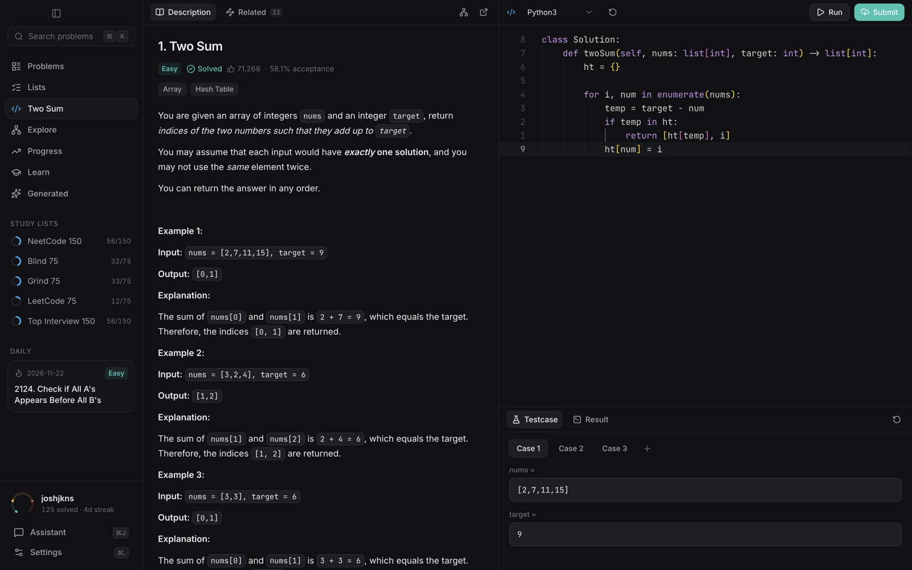
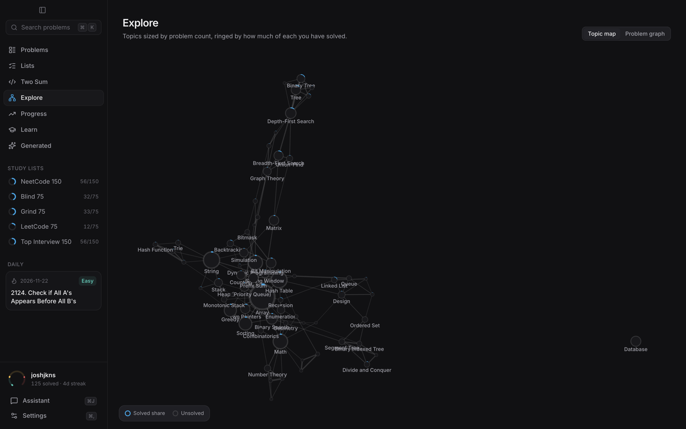
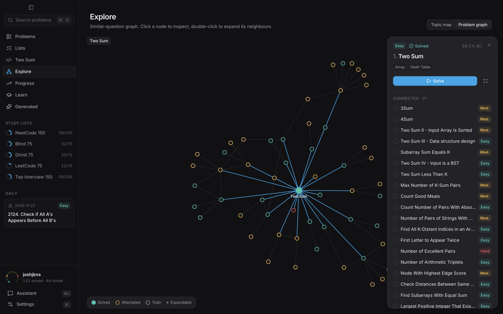
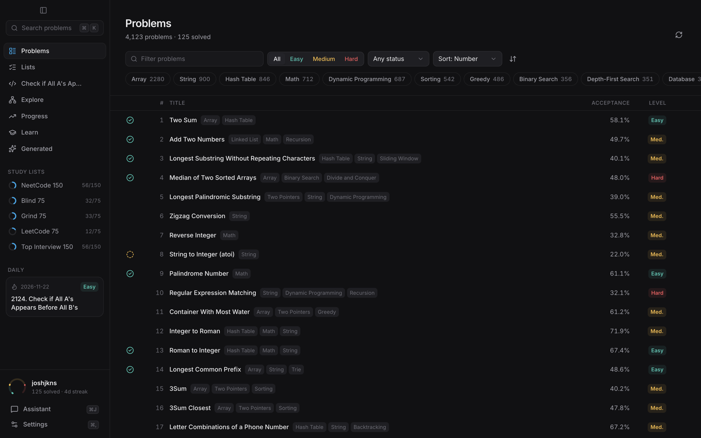

<!-- LOGO -->
<h1>
<p align="center">
  
  <br>LeetHelp
</h1>
  <p align="center">
    A fast, clean LeetCode client for macOS and Windows.
    <br />
    Read, solve, run and <i>actually submit</i> without opening a browser tab.
    <br />
    <a href="#about">About</a>
    ·
    <a href="https://github.com/joshjkns/leethelp/releases">Download</a>
    ·
    <a href="#features">Features</a>
    ·
    <a href="#shortcuts">Shortcuts</a>
    ·
    <a href="#developing">Developing</a>
  </p>
</p>

<p align="center">
  
</p>

## About

LeetHelp is a desktop app for practising on LeetCode. It talks straight to
LeetCode's own API, so the problem set, your solved status, and your
submissions are the same ones you see on the website. Runs and submissions
go through your account and count toward your profile.

It started from a few gripes with the site: it's slow, busy and full of
distractions, and it doesn't help you see how problems relate to each other.
LeetHelp aims to fix those:

- **Fast.** The problem set is cached locally and refreshed in the
  background. Search covers all ~4,000 problems as you type, and switching
  views keeps the editor mounted.
- **Clean.** It's one quiet interface built on Radix primitives, Inter and
  JetBrains Mono, with a translucent macOS sidebar.
- **Connected.** You can browse problems as a graph instead of a list.

## Features

### Workspace

The layout matches the website: description on the left, Monaco editor on
the right, test console below.

- Starter code for every language LeetCode supports, with per-problem drafts
  that autosave
- Editable test cases, one field per parameter, which you can add or remove
- **Run** against your cases and **Submit** for real, with results showing
  runtime and memory percentiles, the failing input, expected vs. actual
  output, and stdout
- Hints, similar questions, and problems that share topics

### Explore

<p align="center">
  
  
</p>

- **Topic map.** Every LeetCode tag is a node, sized by how many problems it
  has and ringed by how much of it you've solved. Edges link topics that
  often appear together. Click a topic to list its unsolved problems.
- **Problem graph.** Start from any problem and follow LeetCode's "similar
  questions". Nodes are coloured by difficulty and filled once solved.
  Double-click a node to expand it, or re-centre the graph on it, and use
  the breadcrumbs to go back.

### Problems

<p align="center">
  
</p>

A virtualised list of the whole problem set. You can filter by difficulty,
status and topic, sort by number, difficulty or acceptance, and jump to
today's daily challenge from the sidebar.

### Lists

NeetCode 150, Blind 75, Grind 75, LeetCode 75 and Top Interview 150, split
into their topic sections. Each list shows your progress (also in the
sidebar), a button that opens your next unsolved problem, and a toggle to
hide the ones you've solved.

### Progress

When you're signed in, this view shows the same numbers as your profile: the
solved ring split by difficulty, "beats" percentages, streak, a year-long
submission heatmap, topic breakdowns and recent accepted submissions.

### Learn

Quick-fire TypeScript drills for interviews, in four decks: syntax, key
functions (`splice`, `split`, `sort`, `Map`…), logic patterns, and classic
problems with a piece of the solution missing. Answer with
<kbd>1</kbd>–<kbd>4</kbd> or by typing. Missing pieces are graded by running
the tests locally, so any correct code passes. Correct answers build a combo,
and missed cards come back in a Mistakes deck until you've got each one right
twice.

### Generated

Original LeetCode-style problems on any topic: statement, examples,
constraints, hints and 10–15 hidden tests. Each opens in the normal
workspace, where you write the solution from an empty signature. **Run**
compares your output with a reference solution on the editable cases, and
**Submit** runs every hidden test locally. A problem is only saved once its
reference solution passes all of its own tests; if it doesn't, the failures go
back to the model for a fix.

### Assistant

A chat panel (<kbd>⌘</kbd> <kbd>J</kbd>) that's part of the app rather than
beside it. It sees the page and problem you're on, and can search and open
problems, write new ones and open them, read your code, run it on edge cases,
submit generated problems, and check your progress and study lists. A single
conversation can go from "make me a medium interval problem" to working
through it with hints. By default it coaches rather than solves, and it only
touches your code when you ask. Drag its left edge to resize it. Every
problem it writes has a **Chat** button that takes you back to the
conversation, scrolled to where the problem was made.

Generation and the assistant run your installed
[Claude Code](https://docs.claude.com/en/docs/claude-code) CLI with its login,
so install it and run `claude` once to sign in. The Generate button can also
use an Anthropic API key, stored encrypted with the system keychain.

### Customisation

- Light, dark or system theme, plus 8 accent colours
- A collapsible sidebar (<kbd>⌘</kbd> <kbd>B</kbd>) and a translucent-sidebar
  toggle
- Interface scale, square or rounded workspace panels, and an option to put
  the editor on the left
- Editor font, size, ligatures, tab width, **Vim mode**, relative line
  numbers, word wrap and minimap
- Default language, and options to hide Premium problems or topic tags

## Shortcuts

| Action | Keys |
| --- | --- |
| Command palette / jump to problem | <kbd>⌘</kbd> <kbd>K</kbd> |
| Run sample tests | <kbd>⌘</kbd> <kbd>'</kbd> |
| Submit | <kbd>⌘</kbd> <kbd>↵</kbd> |
| Toggle sidebar | <kbd>⌘</kbd> <kbd>B</kbd> |
| Problems · Lists · Workspace · Explore · Progress · Learn · Generated | <kbd>⌘</kbd> <kbd>1</kbd>–<kbd>7</kbd> |
| Assistant | <kbd>⌘</kbd> <kbd>J</kbd> |
| Settings | <kbd>⌘</kbd> <kbd>,</kbd> |

## Download

Get the latest release from
[Releases](https://github.com/joshjkns/leethelp/releases).

### macOS (Apple Silicon)

Download the `.dmg` and drag LeetHelp into Applications.

LeetHelp is signed ad-hoc but not notarised by Apple, so macOS blocks it the
first time you open it. To allow it, either:

- open it once, then go to **System Settings → Privacy & Security** and click
  **Open Anyway**, or
- run this in a terminal:

  ```sh
  xattr -dr com.apple.quarantine /Applications/LeetHelp.app
  ```

### Windows (x64)

Download `LeetHelp-<version>-setup-x64.exe` and run it. It installs for your
user only, no admin needed. The installer isn't code-signed, so SmartScreen
may warn you: click **More info → Run anyway**.

### Signing in

Click **Sign in to LeetCode** in the sidebar. LeetCode opens in your default
browser, where you're probably already logged in. Click **Authorize** and
LeetHelp picks up the session. This works with any login method, including
Google and GitHub. (It uses the authorize page LeetCode built for its VS Code
extension, so LeetHelp briefly handles `vscode-insiders://` links during
sign-in. It won't if VS Code Insiders is installed.)

If that doesn't work, open **Settings → Account**. You can sign in in an
in-app window (email/password), or paste your `LEETCODE_SESSION` and
`csrftoken` cookies from your browser's DevTools.

Your session stays on your computer, in the app's own browser partition. It's
only ever sent to `leetcode.com`.

## Developing

You need Node 20+ and [pnpm](https://pnpm.io).

```sh
pnpm install
pnpm dev        # run with hot reload
pnpm build      # production build into out/
pnpm start      # run the production build
pnpm dist       # package dist/mac-arm64/LeetHelp.app (+ .dmg)
pnpm typecheck
```

**Stack:** Electron · React 19 · TypeScript · Tailwind CSS 4 · Radix UI ·
Monaco · react-force-graph · Motion · Zustand

```
src/
  main/        Electron main process + LeetCode API client (GraphQL, run/submit, cache)
  preload/     typed IPC bridge (window.api)
  shared/      types shared by both sides
  renderer/    React app: views/, components/, lib/
```

---

<p align="center"><sub>Not affiliated with LeetCode.</sub></p>
